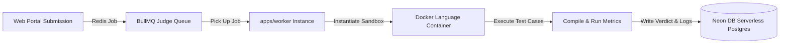

# CodeProctor_ Sandboxed Execution Worker (`apps/worker`)

This microservice acts as the isolated **Asynchronous Code Evaluation and Grading Engine** for CodeProctor. It safely evaluates arbitrary candidate source code against hidden verification test cases inside ephemeral Docker language containers.

---

## ⚙️ How the Judge Queue Works

To protect our production API servers from malicious code or denial-of-service loops, code execution happens asynchronously off the primary HTTP critical path:



### The Evaluation Lifecycle:
1. **Queue Reception**: The worker continuously consumes background jobs from **BullMQ** (using Redis as the transport buffer).
2. **Sandbox Creation**: For each incoming `Submission` ID, the worker extracts the candidate source code, selected language runtime (`python3.11`, `cpp`, `java`, or `nodejs`), and corresponding `TestCase` rows from Neon DB.
3. **Isolated Docker Execution**: Code is compiled and run inside an isolated Docker container with strict memory limits (KB), execution CPU timers (ms), and zero network egress access.
4. **Verdict Generation**: The worker compares actual stdout against expected outputs, assigning granular Codeforces-style verdicts per test case:
   - `ACCEPTED` (AC)
   - `WRONG_ANSWER` (WA)
   - `TIME_LIMIT_EXCEEDED` (TLE)
   - `MEMORY_LIMIT_EXCEEDED` (MLE)
   - `RUNTIME_ERROR` (RE)
   - `COMPILATION_ERROR` (CE)
5. **Database Sync**: Final aggregate verdicts and per-stage compilation logs are recorded into the database (`SubmissionTestCase` and `ExecutionLog` tables).

---

## 🚀 Setup & Requirements

### Prerequisites
- **Docker Engine**: Docker Desktop or Linux Docker Engine must be installed and running locally so the worker can spin up container sandboxes.
- **Redis Server**: A running Redis instance (local or Upstash Redis cloud) for BullMQ job queue management.

### Starting the Worker Service
```bash
# Navigate to worker directory
cd apps/worker

# Install dependency modules
npm install

# Run development worker queue listener
npm run dev
```

---

## 🔒 Security Guarantee
All user-submitted code runs under low-privilege execution users within transient container file systems that are wiped clean instantly after evaluation.
