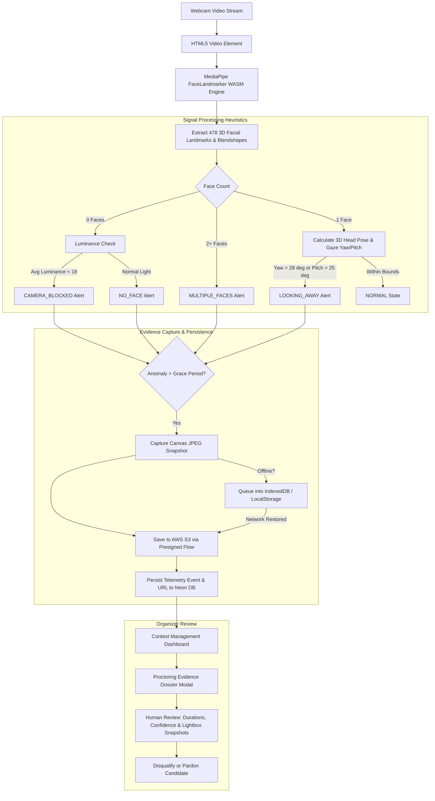

# Computer Vision Proctoring Architecture & Operational Guide

This document explains the end-to-end technical architecture, signal extraction heuristics, data flows, and design decisions behind CodeProctor's **Computer Vision (CV) Proctoring** system.

---

## 1. Executive Summary & Core Philosophy

Traditional proctoring platforms often rely on:
1. Continuous video streaming to expensive backend servers, causing high latency, high cloud bandwidth costs, and privacy concerns.
2. Opaque "black-box trust scores" that arbitrarily deduct points or falsely accuse candidates of cheating without explainable evidence.

**CodeProctor adopts an Evidence-First, Client-Side Edge Architecture:**
* **Zero Video Streaming Overhead**: Face detection, gaze estimation, and luminance metrics run entirely inside the candidate's browser via **MediaPipe Face Landmarker (WebAssembly / TensorFlow Lite)**.
* **Objective Anomaly Evidence (No Guesswork)**: The system does not calculate an artificial "cheating score". It records raw, verifiable events (`NO_FACE`, `MULTIPLE_FACES`, `LOOKING_AWAY`, `CAMERA_BLOCKED`, `FULLSCREEN_EXIT`, `TAB_SWITCH`, `CAMERA_DISCONNECTED`).
* **Evidence Dossier for Organizers**: When an anomaly persists beyond baseline thresholds, the browser captures a single compressed visual snapshot and syncs it to AWS S3. The contest organizer reviews the evidence timeline with exact durations, confidence scores, and snapshots before making human disciplinary decisions.

---

## 2. Why is `apps/cv-service` Empty and Why Don't We Need It?

During early monorepo planning, `apps/cv-service` was created as an empty placeholder intended for a Python/OpenCV microservice. However, implementing real-time proctoring via a backend Python service introduces critical drawbacks:

| Metric / Consideration | Backend Python Microservice (Server-Side) | CodeProctor WebAssembly Architecture (Client-Side Edge) |
| :--- | :--- | :--- |
| **Server Bandwidth & Compute** | Huge cost. Streaming 10-30 FPS video for 500 candidates requires gigabits/sec of bandwidth and heavy GPU clusters. | **Zero server video cost**. Video is processed locally on candidate's CPU via WebAssembly (XNNPACK). |
| **Network Latency & Jitter** | Poor home connections drop frames, causing false alarms and disconnect errors. | **Immune to stream drops**. Model runs locally even if internet temporarily fluctuates. |
| **Privacy & Compliance** | Storing continuous video feeds of students' bedrooms violates privacy laws (GDPR, FERPA). | **Privacy-Preserving**. Candidate's continuous video stream never leaves browser memory. Only anomaly snapshot frames are stored. |
| **Scalability** | Linear scaling cost ($$$) per concurrent participant. | Scales infinitely to thousands of concurrent test takers at $0 incremental video compute cost. |

> **Conclusion**: `apps/cv-service` is **not needed** for real-time proctoring in CodeProctor. All AI computer vision execution takes place in [`apps/web/src/hooks/useComputerVisionProctor.ts`](file:///d:/Slides/S9/CodeProctor/apps/web/src/hooks/useComputerVisionProctor.ts). The folder remains as an optional placeholder only if you decide in the future to build offline batch ID-card verification or secondary post-contest model auditing.

---

## 3. End-to-End Proctoring Pipeline

---

## 4. Signal Heuristics & Detection Mechanics

All thresholds are centralized and configurable in [`apps/web/src/lib/proctoring/cvThresholds.ts`](file:///d:/Slides/S9/CodeProctor/apps/web/src/lib/proctoring/cvThresholds.ts):

### A. Face Absence (`NO_FACE`)
* **Detection**: `faces.length === 0` while average frame luminance $> 18$.
* **Grace Period**: $4.5\text{ seconds}$ continuous absence.
* **Rationale**: Prevents false alarms if a candidate briefly sneezes, bends down to pick up a pen, or adjusts their chair.

### B. Multiple Faces (`MULTIPLE_FACES`)
* **Detection**: `faces.length >= 2`.
* **Grace Period**: $2.0\text{ seconds}$ continuous presence.
* **Rationale**: Short grace period to ignore a passerby walking quickly in the background, but rapidly flags unauthorized collaboration.

### C. Gaze & Head Deviation (`LOOKING_AWAY`)
* **Detection**: 3D geometric pose estimation based on nose tip (landmark 1), chin (landmark 152), and eye corners (landmarks 33 & 263).
  $$\text{Yaw} = \arctan2(x_{\text{nose}} - x_{\text{mid}}, z_{\text{nose}} - z_{\text{mid}})$$
* **Trigger**: $|\text{Yaw}| > 28^\circ$ or $|\text{Pitch}| > 25^\circ$.
* **Grace Period**: $4.0\text{ seconds}$.
* **Rationale**: Candidates naturally glance away momentarily while thinking or checking their keyboard. Only sustained off-screen gaze triggers an evidence capture.

### D. Lens Blockage vs. Dark Room (`CAMERA_BLOCKED`)
* **Detection**: `faces.length === 0` AND average grayscale luminance across frame pixels $< 18$ (scale 0-255).
* **Grace Period**: $3.0\text{ seconds}$.
* **Rationale**: Distinguishes a candidate walking away (`NO_FACE`) from deliberate camera tampering (covering the webcam with a thumb, sticker, or paper).

### E. Hardware / Disconnect Grace Period (`CAMERA_DISCONNECTED`)
* **Detection**: Media stream track termination or failure of the browser frame loop.
* **Grace Period**: $10.0\text{ seconds}$.
* **Rationale**: Gives candidates time to re-plug a loose USB webcam before triggering an audit infraction.

---

## 5. Candidate User Experience

### 1. Pre-Assessment Calibration Modal (`CameraCalibrationModal.tsx`)
Before entering a `CV_PROCTORED` contest, candidates must complete an automated 6-step checklist:
1. **Camera Permission Verification**: Confirms browser video access.
2. **Environment & Lighting Check**: Verifies image is not under-exposed or over-exposed.
3. **Single Face Framing**: Ensures candidate's face is centered in the bounding box.
4. **Neutral Baseline Gaze Zeroing**: A 5-second countdown where the candidate looks directly at their code area. Their natural posture becomes the neutral $(0^\circ, 0^\circ)$ baseline.
5. **Kiosk Fullscreen Agreement**: Prompts candidate to lock into fullscreen mode.

### 2. Picture-in-Picture Webcam HUD (`WebcamHUD.tsx`)
During the assessment inside `ArenaIDE`:
* A floating, draggable picture-in-picture window shows the candidate's mirrored live video feed.
* A live compliance ring displays current status:
  * 🟢 **Face Aligned • 1 Face** (Normal)
  * 🟡 **Gaze Shifted** (Candidate looking away)
  * 🔴 **Face Not In Frame / Lens Blocked / Multiple Faces** (Active anomaly countdown)
* Candidates can minimize the HUD to a small status pill to preserve screen space or click the recalibrate button if they change seating positions.

---

## 6. Snapshot & Storage Lifecycle

1. **Anomaly Capture**: When an anomaly timer breaches its grace threshold, `useComputerVisionProctor` creates an off-screen HTML5 canvas, draws the current video frame, scales it to $640 \times 480$, and compresses it to a lightweight JPEG (quality 0.65, typically $\approx 25\text{ KB}$).
2. **S3 Cloud Upload**: The frame is transmitted via server action to [`s3Snapshots.ts`](file:///d:/Slides/S9/CodeProctor/apps/web/src/lib/proctoring/s3Snapshots.ts).
   * Key pattern: `proctoring/<contestId>/<proctorSessionId>/<violationId>_<timestamp>.jpg`
   * Bucket: Set in `.env` (`AWS_S3_BUCKET_NAME`).
3. **Graceful Fallback**: If AWS S3 credentials are not configured (e.g. during local testing), the server automatically saves the snapshot as a base64 data URI in the `File` table (`local-memory` bucket). Testing works out of the box with zero setup.
4. **Offline Queueing (`offlineQueue.ts`)**: If the candidate loses internet connectivity, snapshots and violation payloads are stored in browser `IndexedDB`. When the browser emits an `online` event, the queue automatically flushes all pending events to the server.
5. **Organizer Review (`ProctoringEvidenceTimeline.tsx`)**:
   * S3 snapshots are private. Organizers access them through **15-minute time-limited AWS Presigned GET URLs** generated server-side.
   * Organizers view an interactive timeline with duration badges, confidence levels, and full-resolution image lightboxes.

---

## 7. Key File Map

| Component / Utility | File Path | Responsibility |
| :--- | :--- | :--- |
| **Inference Hook** | `apps/web/src/hooks/useComputerVisionProctor.ts` | MediaPipe WASM loader, throttled 12.5 FPS loop, pose math, luminance, anomaly timers, snapshot generation. |
| **Threshold Config** | `apps/web/src/lib/proctoring/cvThresholds.ts` | Centralized calibration defaults (durations, angles, intervals). |
| **S3 Storage & Presigning** | `apps/web/src/lib/proctoring/s3Snapshots.ts` | AWS S3 PutObject, presigned GetObject URLs, fallback storage. |
| **Offline Sync Queue** | `apps/web/src/lib/proctoring/offlineQueue.ts` | IndexedDB persistent queue with online auto-drain. |
| **Calibration Modal** | `apps/web/src/components/contests/CameraCalibrationModal.tsx` | 6-step pre-assessment setup and neutral gaze zeroing. |
| **Webcam HUD** | `apps/web/src/components/contests/WebcamHUD.tsx` | Draggable floating webcam viewfinder with compliance ring. |
| **Evidence Dossier** | `apps/web/src/components/contests/ProctoringEvidenceTimeline.tsx` | Organizer timeline modal with duration pills and snapshot lightbox. |
| **Contest Server Actions** | `apps/web/src/app/actions/contests.ts` | Server telemetry ingestion (`recordContestViolationServer`), organizer queries. |
